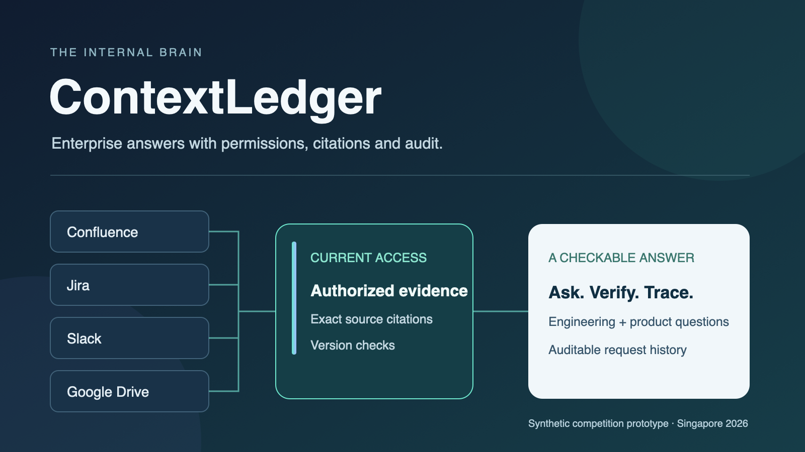

# ContextLedger — The Internal Brain

Permission-aware enterprise answers with evidence and audit trails.

Built by **Team AI Bang2** for the **Tencent Cloud AI CAN DO IT Hackathon Singapore 2026**, FinTech / Aspire challenge.



**[Watch the project demonstration (7m 32s)](https://youtu.be/BULowhVNfU8)** — English narration and captions, with a live question and clearly labelled fixture scenarios.

## Try ContextLedger

**[Open the hosted demo](https://contextledger.hellokyleshi.com)** → Workspace → choose a demo perspective → sign in.

Engineering, Product & Operations, External Partner and Audit reviewer have different configured access. The sign-in page supplies the shared demo credentials. Questions, saved answers and the trial allowance are shared; use fictional information only. The demo uses synthetic payment-service materials in real Confluence, Jira, Slack and Google Drive. It is hosted on a team member's Mac, so availability depends on that computer and its tunnel staying online.

Start with: **“Is PAY-102 complete, and can we offer payment-retry to all customers today?”** Inspect the answer's exact supporting quotes and open a source preview to check its context and version. Completing a code fix is distinct from approving a general release.

### Run locally without credentials

Requires Python 3.11 or newer. From the repository root:

```sh
python3 -m scripts.reviewer_demo --accounts --open
```

This local mode uses **synthetic fixtures and a fake extractive model**. It needs no API keys, platform accounts, package installation or model payments. The terminal prints the local URL and the location of generated login cards. Keep it open; Ctrl+C stops the server. Local outputs stay in the ignored `.runtime/` directory.

## What it does

ContextLedger helps engineers investigate incidents and product colleagues check delivery and release readiness across four tools. Each question is independent. Answers bring together relevant evidence, separate supported information from gaps, and link back to exact source passages. Saved answers and source previews are checked again before access.

| Challenge scenario | Implementation and demonstration |
|---|---|
| Unified query | Retrieve authorized evidence across Confluence, Jira, Slack and Google Drive; organize reviewed conclusions by subquestion. |
| Freshness | Publish source versions incrementally and show source-update, indexing and access-check times. |
| Permission denial | Apply server-side identity and resource policy; unknown access cannot pass. |
| Dynamic revocation | Recheck current source access, saved answers and previews; demonstrate controlled mutations in the isolated fixture lab. |
| Audit | Inspect scoped request events; verify exported audit chains against Ed25519 checkpoints with the CodeBuddy component. |

The hosted trial uses reviewed synthesis. The credential-free demo and scenario lab use fake models. These modes provide different evidence and are labelled accordingly.

## Read the project

- [Architecture, trust boundaries and design tradeoffs](docs/IMPLEMENTED_ARCHITECTURE.md)
- [Local setup and verification](docs/QUICKSTART.md)
- [Five-scenario demonstration guide](docs/DEMO.md)
- [Security model and deployment limits](docs/SECURITY.md)
- [Validation scope and remaining limitations](docs/VALIDATION.md)
- [CodeBuddy's implementation contribution](docs/CODEBUDDY_CONTRIBUTION.md)
- [Submission description](docs/SUBMISSION.md)

## Repository layout

```text
brain/     Application, retrieval, native readers, models, authorization and audit
web/       Browser interface and bundled visual assets
scripts/   Launch, configuration and verification utilities
config/    Placeholder integration examples and policy compatibility data
fixtures/  Synthetic business scenarios
tests/    Automated tests, minimal regression data and test support
tools/    Independent CodeBuddy audit verifier
assets/    Cover and architecture images
docs/     Reviewer and developer documentation
```

## Verification

Python tests use the standard library. Frontend tests require an existing Node.js installation; signature and local HTTPS tests require an OpenSSL executable with Ed25519 support.

```sh
python3 -m unittest discover -s tests
python3 -m scripts.competition_check --output .runtime/validation/rehearsal
```

The rehearsal directory must be new; earlier results are preserved. Commands above use fixtures and mocks, not live credentials or paid models. [Validation details](docs/VALIDATION.md) explain what their results establish.

## Prototype scope

The system has native API integrations and scoped access checks, but it does not establish enterprise SSO, a complete employee permission matrix or independent production audit custody. Full semantic acceptance remains incomplete: model review can miss errors or reject useful answers. No measured customer ROI, stable latency SLA or prompt-injection immunity is claimed. This repository contains application source, tests and concise project documentation; operator credentials, raw development records and generated results stay outside the submission tree.
