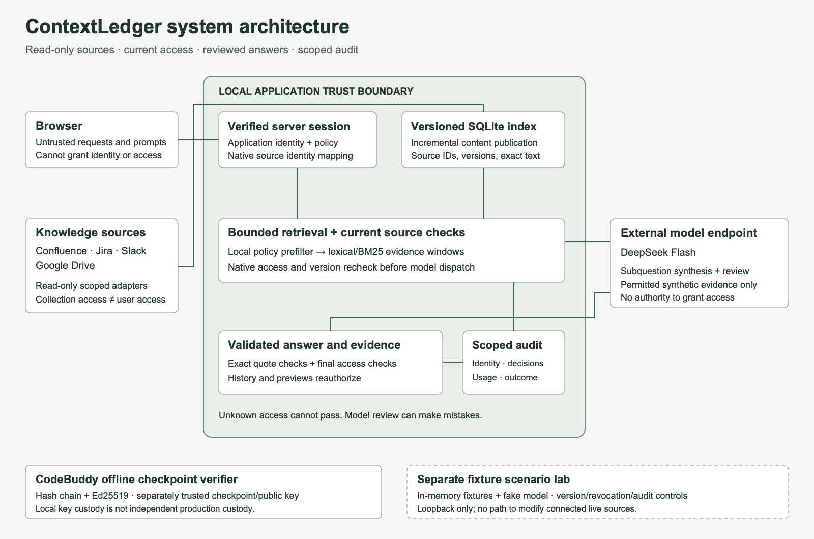

# Architecture and design tradeoffs

ContextLedger is a Python and SQLite knowledge prototype with a browser interface. It combines read-only source adapters, local retrieval, current access checks, reviewed answers and scoped audit records.

[Download the vector diagram](../assets/submission/contextledger-architecture.svg).

## Request and data flow

1. **Establish identity.** The server validates the session and obtains the application identity. In the hosted demonstration, each shared identity has a resource policy intersected with the team connection's native access. Client fields and model output cannot grant permissions.
2. **Maintain source versions.** Read-only adapters collect approved synthetic material from Confluence, Jira, Slack and Google Drive. Incremental discovery publishes complete versions to the local index; content changes and access changes are handled separately.
3. **Retrieve bounded evidence.** Local lexical/BM25 ranking, a bounded bilingual glossary and exact text windows select candidates after a policy prefilter. Evidence keeps its source ID, version, locator and original text.
4. **Verify current access.** Native source permission and version checks run before evidence is supplied to a model. Denied, unknown or inconsistent access cannot be treated as permission. A bounded pre-model version recovery can refresh changed evidence; it does not permit post-generation retries against different content.
5. **Generate and review.** The hosted `sectioned-synthesis` path asks the model for conclusions by subquestion, exact supporting quotes, qualifications and explicit gaps. Strict structural and quote checks and a separate model review assess the draft. A rejected draft is not released as a successful synthesized answer; evidence-only output remains visibly distinct.
6. **Deliver and retain.** Final access checks guard the answer. Historical answers and source previews are reauthorized. The audit stream records identity, question, resource decisions, evidence, model attempts, usage and outcome.

## Trust boundaries

| Boundary | Enforced distinction |
|---|---|
| Browser → server | A verified session determines identity; prompts, roles in request text and client user IDs do not grant access. |
| Index → native sources | An indexed copy or service-account read does not establish an employee's current permission. |
| Evidence → model | Retrieved text is untrusted data. The model cannot authorize resources, execute audit SQL or choose arbitrary source URLs. |
| Draft → answer | Syntax and exact-quote checks are deterministic; semantic model review is fallible. Current access remains a server decision. |
| User → audit | Audit queries use restricted structured conditions and explicit actor/resource scope. |
| Application → host | The tunnel routes inbound traffic; it does not isolate the process from files available to its operating-system account. |

The isolated scenario lab has its own in-memory fixtures and fixed controls. It is separate from the employee-facing server and has no route to modify live sources.

## Why these choices

| Choice | Benefit | Tradeoff |
|---|---|---|
| Python standard library and SQLite | Straightforward local reproduction and inspectable state. | A single-host prototype; production isolation and scaling are separate work. |
| Bounded lexical/BM25 retrieval | Exact source windows and simple diagnostics for a small prepared corpus. | Limited vocabulary and corpus coverage; no demonstrated embedding advantage or general semantic retrieval guarantee. |
| Read-only adapters with current checks | Limits source mutations and avoids relying on stale local allows. | Native API availability and supported resource types constrain answers. |
| Generation plus separate review | Adds an explicit check for scope, gaps, false premises and conflicting evidence. | Adds latency and cost; review can miss mistakes or reject useful drafts. |
| Hash chain plus signed checkpoints | Detects changes to records covered by a separately trusted checkpoint. | Local key/checkpoint custody is not independent production protection; uncovered tails remain unanchored. |
| Shared synthetic demo identities | Lets reviewers compare application access without provisioning enterprise accounts. | Shared history and allowance; not employee SSO or proof of every native ACL case. |

An additional isolated-quotation review path exists as an experiment and is **off in the hosted demonstration**. It has not passed full end-to-end acceptance. [Validation](VALIDATION.md) and [Security](SECURITY.md) describe the scope without treating test results as production guarantees.

## Implementation map

- `brain/engine.py`, `brain/retrieval.py`: evidence selection, authorization phases and answer handling.
- `brain/ingestion.py`, `brain/discovery.py`: incremental version publication and bounded source discovery.
- `brain/confluence.py`, `brain/jira.py`, `brain/slack.py`, `brain/drive.py`: source-specific access and content readers.
- `brain/deepseek.py`, `brain/synthesis.py`: bounded model transport, strict parsing and review paths.
- `brain/reviewer_access.py`, `brain/server.py`: verified sessions, application policy and HTTP boundary.
- `brain/audit.py`, `brain/audit_query.py`, `tools/audit_verifier/`: scoped events, queries and independent verification.
- `web/`: workspace, historical answers, evidence previews and audit interface.
